# ESP32-Sensores

Projeto em desenvolvimento com ESP32, LDR, DHT11, API em Node.js e banco MySQL. As duas primeiras etapas recuperam os **códigos originais dos testes isolados**; depois, o tutorial mostra a integração que já enviou medições reais para a API e o banco.

As fotos e capturas estão em `_assets/images` e `_assets/screenshots`. Cada imagem aparece junto da etapa que ilustra. Os comandos de terminal deste tutorial são para o **Prompt de Comando do Windows (CMD)**.

## 1. Teste do LDR com LED

A montagem registrada nas fotos usa ESP32, protoboard, LDR e LED. Confira a ligação dos componentes e use resistor para limitar a corrente do LED. As fotos documentam o teste realizado; confira os pinos pelo código antes de montar.

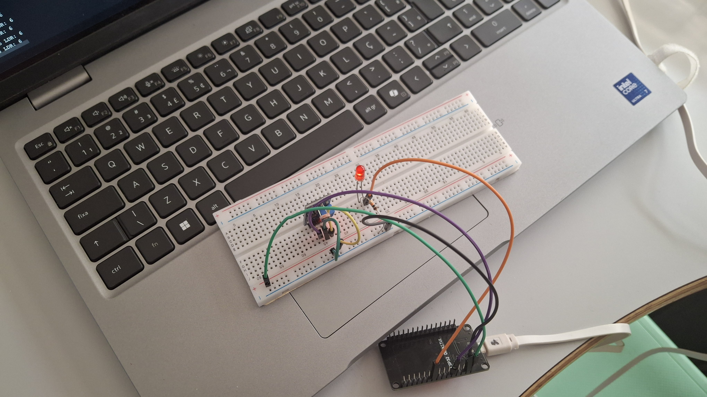

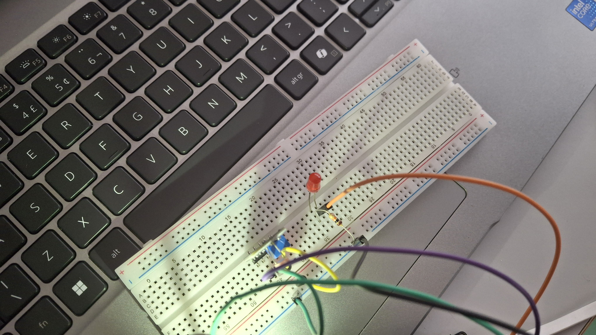

Na Arduino IDE, selecione a placa e a porta do ESP32. Crie um sketch para **este teste isolado** com o código que já constava no README:

```cpp
const int ldrPin = 4; // Pino ADC onde o LDR está conectado
const int ledPin = 18; // Pino do LED para acionar

void setup() {
  Serial.begin(9600); // Inicia a comunicação serial
  pinMode(ledPin, OUTPUT); // Configura o pino do LED como saída
  pinMode(ldrPin, INPUT);
}

void loop() {
  int ldrValue = analogRead(ldrPin); // Lê o valor do sensor LDR
  ldrValue = map(ldrValue, 0, 5000, 30, 0);

  Serial.print("Valor do LDR: ");
  Serial.println(ldrValue);

  if (ldrValue < 26) { // Se estiver mais escuro
    digitalWrite(ledPin, HIGH); // Liga o LED
  } else { // Se estiver mais claro
    digitalWrite(ledPin, LOW); // Desliga o LED
  }

  delay(500); // Aguarda 500 milissegundos antes da próxima leitura
}
```

Envie o sketch ao ESP32 e abra o Monitor Serial em **9600 baud**, a mesma velocidade definida em `Serial.begin(9600)`. A captura mostra a leitura do LDR e o LED acionado no teste:

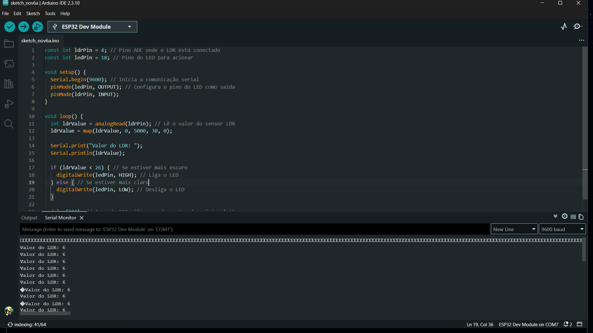

Este exemplo usa GPIO 4 para o LDR e GPIO 18 para o LED. Esses são os pinos do teste isolado; no circuito final com Wi-Fi, o LDR passa para o GPIO 34 (ADC1).

## 2. Teste do DHT11

A foto abaixo mostra a montagem usada no teste separado do DHT11:

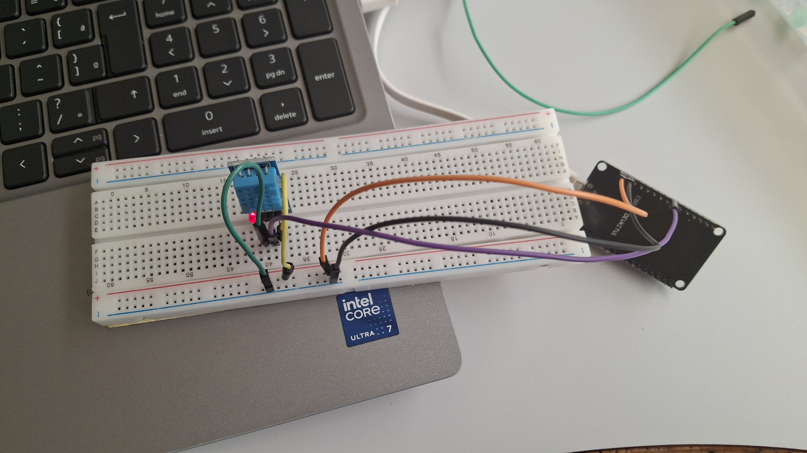

Na Arduino IDE, abra o **Gerenciador de Bibliotecas**, procure **DHT sensor library** da Adafruit e instale-a. Se a IDE solicitar, instale também **Adafruit Unified Sensor**.

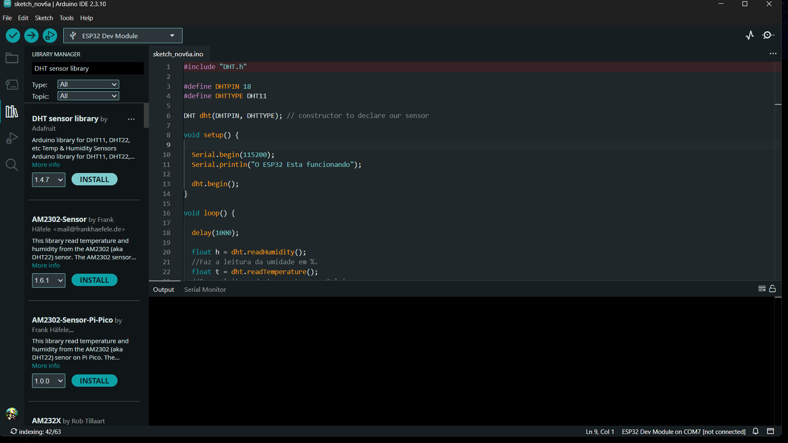

Crie outro sketch para o DHT11. Este é o **código original** recuperado do README anterior:

```cpp
#include "DHT.h"

#define DHTPIN 18
#define DHTTYPE DHT11

DHT dht(DHTPIN, DHTTYPE); // constructor to declare our sensor

void setup() {

  Serial.begin(115200);
  Serial.println("O ESP32 Esta funcionando");

  dht.begin();
}

void loop() {

  delay(1000);

  float h = dht.readHumidity();
  //Faz a leitura da umidade em %.
  float t = dht.readTemperature();
  //Faz a leitura da temperatura em Celsius
  float f = dht.readTemperature(true);
  //Faz a leiturada temperatura em Fahrenheit

  if (isnan(h) || isnan(t) || isnan(f)) {
    Serial.println("Sem receber dados do sensor DHT11");
    return;
    //Trata erros de leitura do sensor
  }

  Serial.print("Umidade: ");
  Serial.print(h);
  Serial.print("%  Temperatura: ");
  Serial.print(t);
  Serial.print("°C, ");
  Serial.print(f);
  Serial.println("°F");

}
```

Envie o sketch e ajuste o Monitor Serial para **115200 baud**, de acordo com `Serial.begin(115200)`. A primeira captura mostra onde selecionar a velocidade; a segunda mostra as leituras de umidade e temperatura.

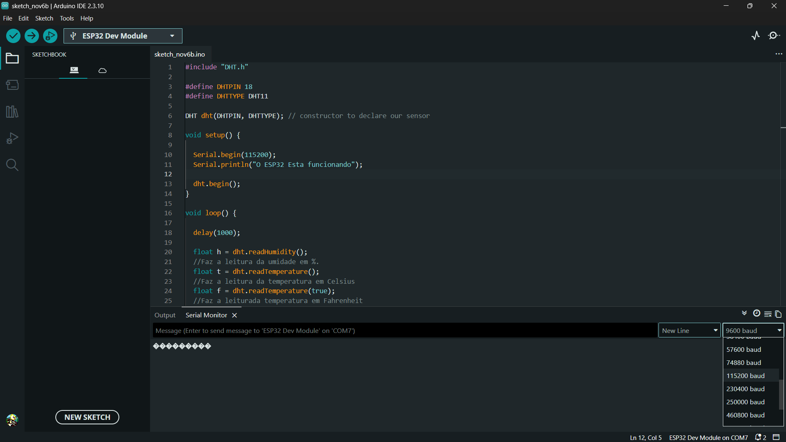

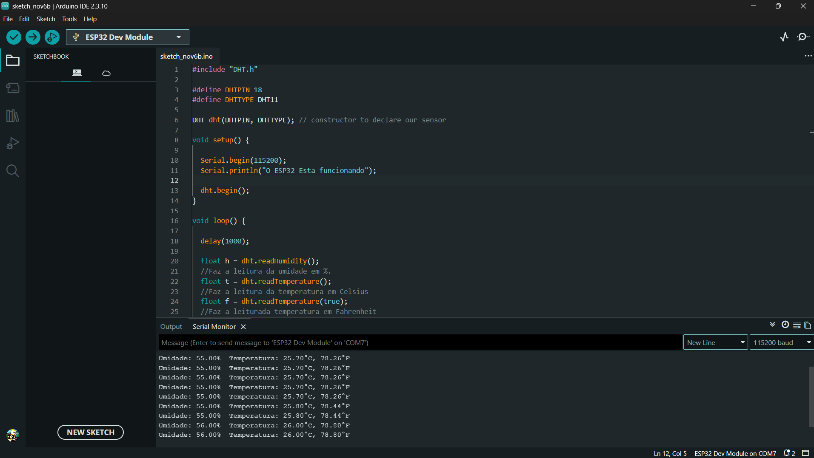

Os dois códigos acima têm funções `setup()` e `loop()` próprias. Execute-os separadamente nesta fase.

## 3. Configure o Prisma e inicie a API

Deixe o MySQL do XAMPP em execução. A API usa o Prisma para aplicar o modelo de dados, sem comandos SQL manuais no MySQL.

Abra o CMD na **pasta raiz do projeto**. Entre na pasta da API e edite o arquivo de ambiente:

```cmd
cd api_iot
```

Use este conteúdo no `api_iot/.env`:

```dotenv
PORT=3000
DATABASE_URL="mysql://root@localhost:3306/medicoes"
```

Essa URL corresponde ao MySQL local com usuário `root` sem senha. Nesta etapa, `api_iot/server.js` fixa a porta 3000; alterar somente `PORT` no `.env` não muda a porta do servidor.

No mesmo CMD, **dentro de `api_iot`**, execute:

```cmd
npm install
npx prisma migrate dev
npx prisma generate
npm run dev
```

`prisma migrate dev` aplica as migrações do Prisma ao banco e pode solicitar um nome para uma nova migração. O último comando, `npm run dev`, inicia o servidor da API. Mantenha o CMD aberto quando aparecer `Servidor respondendo em: http://localhost:3000`. Para interromper o servidor, pressione `Ctrl+C`.

## 4. Teste as rotas no Insomnia

Para testar a API, use o **Insomnia (recomendado)**. Importe o arquivo [`docs/Insomnia_2026-11-06-16-55-54.yaml`](./docs/Insomnia_2026-11-06-16-55-54.yaml) pela opção de importar arquivo do Insomnia. Na pasta **Sensores IOT** da coleção, as requisições já estão prontas:

| Requisição | Método e rota | Resultado |
| --- | --- | --- |
| Medições | `POST http://localhost:3000/medicoes` | Envia temperatura, umidade e luminosidade em JSON e retorna a medição criada com `id` e `data`. |
| Rota inicial | `GET http://localhost:3000/listar` | Lista as medições salvas. |

Deixe a API aberta no CMD durante os testes. Ao enviar a requisição **Medições**, o terminal da API mostra `Medição recebida:`.

## 5. Monte o circuito final e envie o sketch

A foto mostra o circuito com ESP32, DHT11 e LDR usado na integração. Os sinais seguem o sketch: **DHT11 no GPIO 18** e **LDR no GPIO 34 (ADC1)**. O LDR precisa de um divisor de tensão; não aplique 5 V diretamente ao GPIO do ESP32. Confira alimentação e GND dos módulos de acordo com a sua montagem.

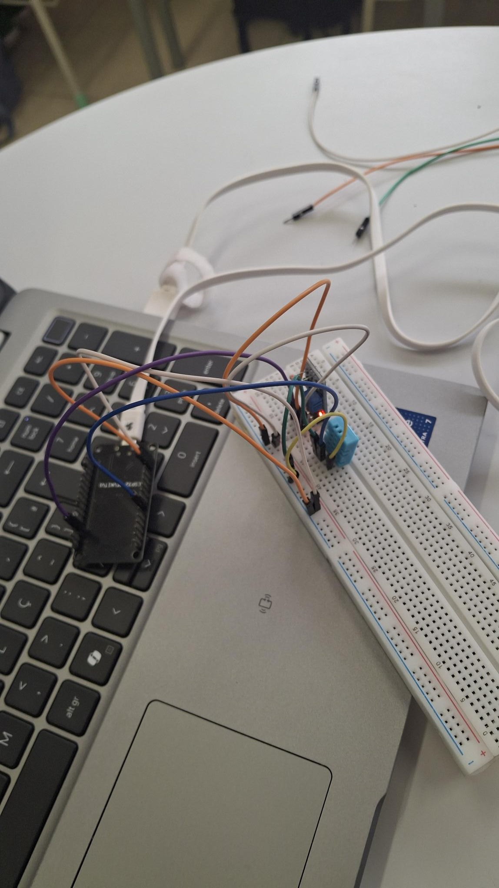

No CMD, descubra o IPv4 do computador que executa a API:

```cmd
ipconfig
```

No teste registrado aqui, o computador usou `192.168.1.150`. O ESP32 e o computador precisam estar na mesma rede. **Ao usar outro computador ou quando o endereço mudar, troque apenas esse IPv4 na `urlApi` do sketch**; mantenha a porta `3000` e a rota `/medicoes`. A rota `/listar` é usada somente para consultar os dados.

Abra o sketch final na Arduino IDE. O código abaixo é o `exemplo.ino` usado no teste; ajuste o IPv4 na `urlApi` conforme o resultado do `ipconfig`:

```cpp
#include <WiFi.h>
#include <HTTPClient.h>
#include <DHT.h>

const char* wifiNome = "TI_SENAI2";
const char* wifiSenha = "senai2025";
const char* urlApi = "http://192.168.1.150:3000/medicoes";

#define DHTPIN 18
#define DHTTYPE DHT11
#define LDRPIN 34

DHT dht(DHTPIN, DHTTYPE);

void setup() {
  Serial.begin(115200);
  delay(1000);
  Serial.println("Iniciando ESP32...");

  dht.begin();
  pinMode(LDRPIN, INPUT);

  WiFi.mode(WIFI_STA);
  WiFi.begin(wifiNome, wifiSenha);

  Serial.print("Conectando ao Wi-Fi");

  for (int tentativa = 0; WiFi.status() != WL_CONNECTED && tentativa < 20; tentativa++) {
    delay(500);
    Serial.print(".");
  }

  if (WiFi.status() == WL_CONNECTED) {
    Serial.print(" conectado! IP do ESP32: ");
    Serial.println(WiFi.localIP());
  } else {
    Serial.print(" sem conexao. Status Wi-Fi: ");
    Serial.println(WiFi.status());
  }

  delay(2000);
}

void loop() {
  if (WiFi.status() != WL_CONNECTED) {
    Serial.println("Wi-Fi desconectado. Tentando reconectar...");
    WiFi.reconnect();
    delay(5000);
    return;
  }

  float temperatura = dht.readTemperature();
  float umidade = dht.readHumidity();
  int luminosidade = analogRead(LDRPIN);

  if (isnan(temperatura) || isnan(umidade)) {
    Serial.println("Erro ao ler o DHT11. Verifique o tipo e a ligacao do sensor.");
  } else {
    String dados = "{\"temperatura\":" + String(temperatura, 1) +
                   ",\"umidade\":" + String(umidade, 1) +
                   ",\"luminosidade\":" + String(luminosidade) + "}";

    Serial.print("Medicao: ");
    Serial.println(dados);

    HTTPClient http;
    http.setTimeout(5000);

    Serial.print("Enviando para: ");
    Serial.println(urlApi);

    if (!http.begin(urlApi)) {
      Serial.println("Nao foi possivel iniciar a requisicao HTTP.");
    } else {
      http.addHeader("Content-Type", "application/json");

      int resposta = http.POST(dados);

      Serial.print("Resposta da API: ");
      Serial.println(resposta);

      if (resposta > 0) {
        Serial.println(http.getString());
      } else {
        Serial.println(http.errorToString(resposta));
      }

      http.end();
    }
  }

  delay(5000);
}
```

Envie **este sketch** para o ESP32, selecione a porta correta e abra o Monitor Serial em **115200 baud**. Depois do reinício, procure `Iniciando ESP32...`, `Medicao:`, `Enviando para:` e **`Resposta da API: 201`**. O número `201` confirma que a API criou a medição. Se aparecerem apenas as mensagens do teste isolado de temperatura e umidade, o sketch final ainda não foi enviado à placa.

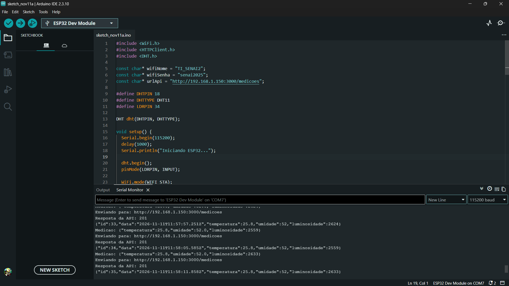

## 6. Confira a medição na API, no banco e na página web

Com o servidor aberto no CMD, cada envio do ESP32 aparece no terminal como `Medição recebida:`:

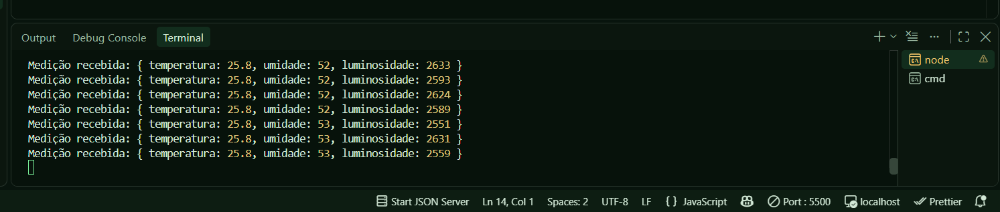

Consulte os dados gravados pela requisição **Rota inicial** (`GET /listar`) no Insomnia.

A captura do MySQL mostra os registros de temperatura, umidade e luminosidade recebidos durante o teste:

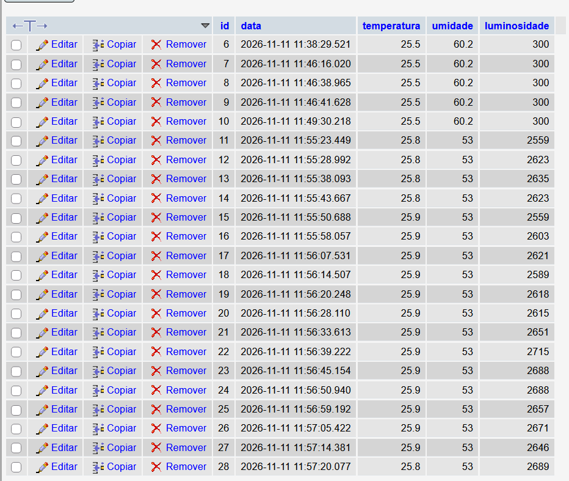

Para testar a parte web, instale a extensão **Live Server** no VS Code. Com a API ainda em execução no CMD, abra o arquivo `index.html` na raiz do projeto, clique com o botão direito e escolha **Open with Live Server**. O navegador abrirá a página e será redirecionado para `web/medicoes.html`. Também é possível abrir `web/medicoes.html` diretamente com o Live Server.

O Live Server serve os arquivos da página; as medições continuam vindo da API em `http://localhost:3000/listar`. Por isso, mantenha o servidor da API ligado durante o teste no mesmo computador.

`screenshot6.png` documenta apenas uma **prévia anterior da interface**:

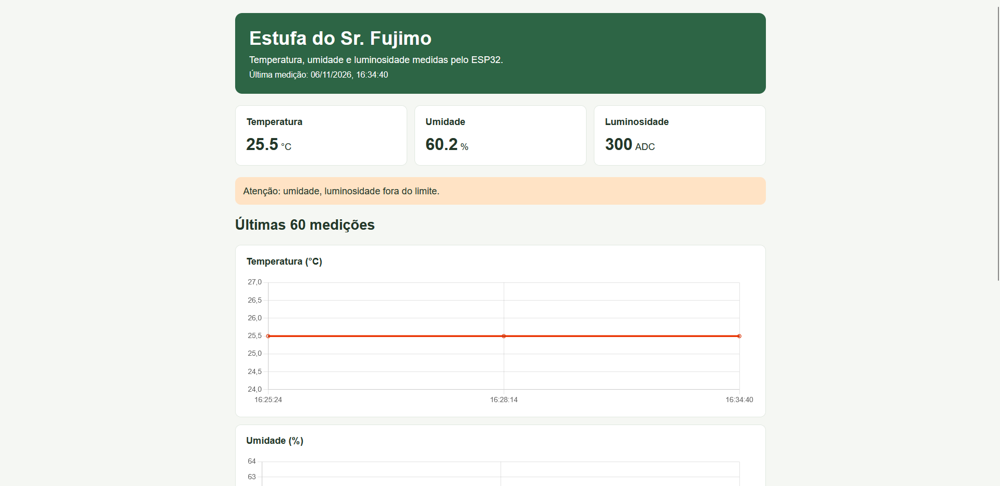

Já a captura abaixo mostra os **gráficos com as medições enviadas pelo ESP32**. A página consulta `GET /listar` e atualiza os valores periodicamente; os gráficos dependem de Chart.js carregado pela internet.

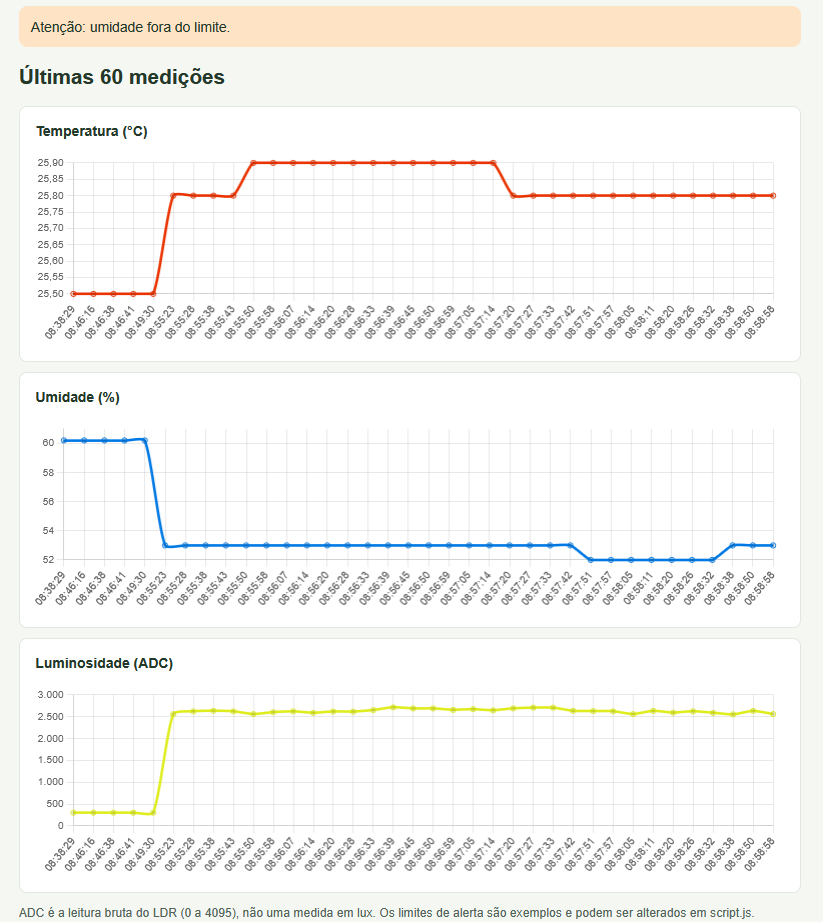

A interface web e os limites de alerta em `web/script.js` ainda podem evoluir.

## Integrantes:

- [zeenvexy](https://github.com/zenvexy)
- [davi-lm7](https://github.com/davi-lm7)
- [Murilo1602](https://github.com/Murilo1602)
- [HenriqueAlth09](https://github.com/HenriqueAlth09)